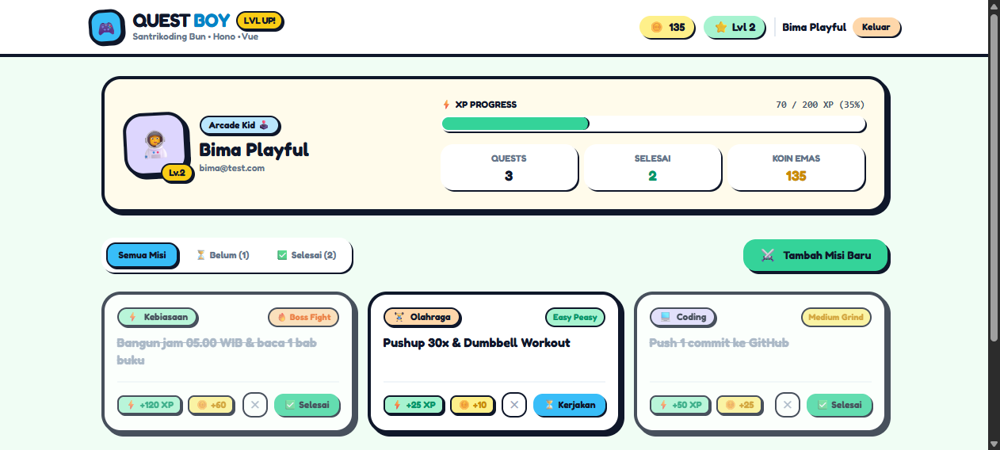

# QuestBoy 🎮⚡

> **Playful Gamified Quest & Habit Tracker** built with **Bun**, **Hono**, **Vue 3**, **TanStack Query**, and **JWT Authentication**.  
> Designed with a **Kartun Pastel & Playful Laki** aesthetic (chunky bold outlines, pastel neobrutalism, arcade boyish vibes).



---

## 🚀 Tech Stack

- **Runtime & Engine:** [Bun 1.4](https://bun.sh)
- **Backend API:** [Hono v4](https://hono.dev) + `@hono/jwt`
- **Frontend SPA:** [Vue 3](https://vuejs.org) + TypeScript + Vite
- **Data Fetching:** [TanStack Vue Query v5](https://tanstack.com/query/latest)
- **Styling:** Tailwind CSS (Custom Pastel Boyish Neobrutalism palette)
- **Database:** FlyEnv MySQL (port 3306) with Bun SQLite fallback
- **Local Dev Server:** Laravel Herd integration (`http://questboy.test`)

---

## ✨ Features

- 🛡️ **JWT Auth Flow:** Register & Login with cartoon avatar selector (`boy_cap`, `boy_gamer`, `boy_astro`, `boy_ninja`).
- ⚡ **XP & Level Progression:** Level formula tiers with dynamic XP bar and gamer titles (*Rookie Boy*, *Arcade Kid*, *Code Knight*, *Boss Slayer*).
- ⚔️ **Daily Quests & Habits:** Categorized quests (Gaming, Coding, Workout, Study, Habit) with difficulty multipliers (Easy Peasy, Medium Grind, Boss Fight).
- 🎉 **Celebration FX:** Confetti blast on completing quests and leveling up.
- 🚀 **Herd & FastCGI Gateway:** `public/index.php` reverse proxies `/api/*` to Hono backend and serves the SPA directly on `questboy.test`.

---

## 🛠️ Quickstart

### 1. Install Dependencies
```bash
# Backend
cd backend
bun install

# Frontend
cd ../frontend
bun install
```

### 2. Run Locally

#### Option A: Direct Development
```bash
# Terminal 1 - Backend (port 3002)
cd backend
bun run dev

# Terminal 2 - Frontend (port 5173)
cd frontend
bun run dev
```

#### Option B: Laravel Herd (`http://questboy.test`)
1. Place project inside Herd sites folder: `C:\Users\Lenovo\Herd\questboy`
2. Build frontend assets:
   ```bash
   cd frontend
   bun run build
   ```
3. Start backend:
   ```bash
   cd backend
   bun run src/index.ts
   ```
4. Open `http://questboy.test` directly in your browser!

---

## 🧪 Tests

```bash
cd backend
bun test
```

---

## 📜 License
MIT © [DevisRoomi](https://github.com/DevisRoomi)
